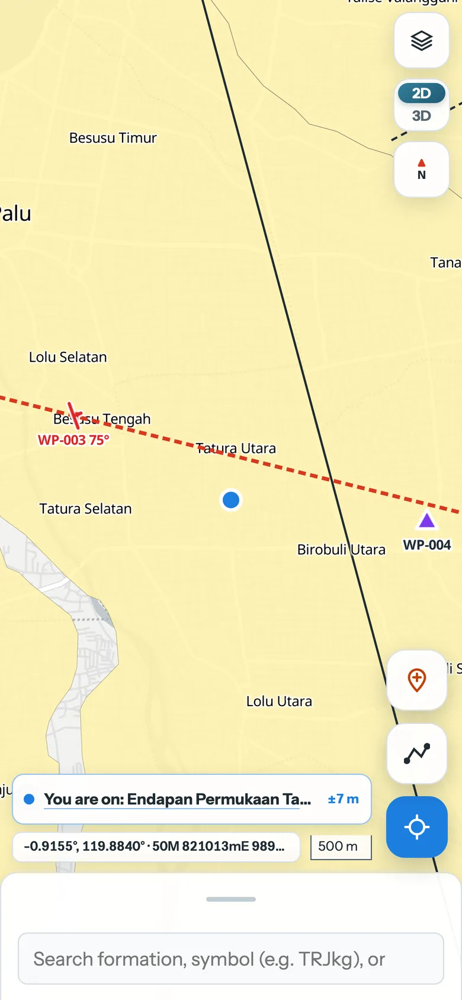
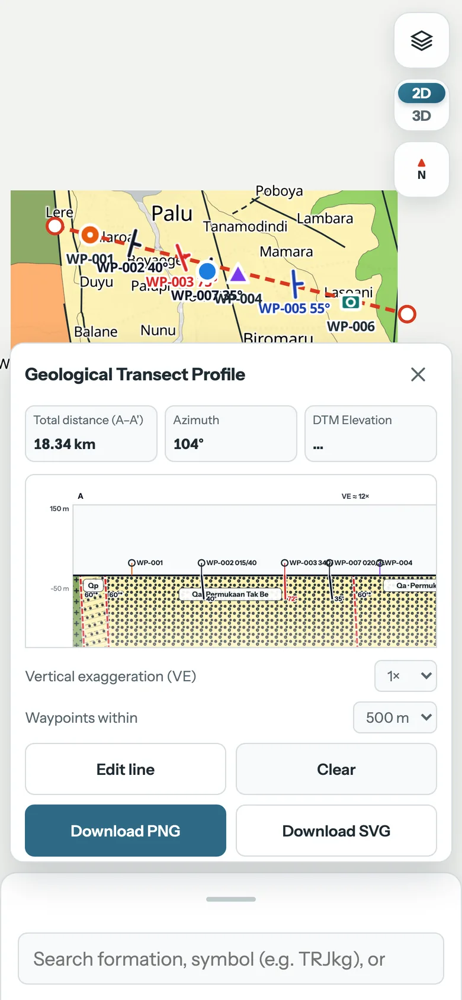

# Orebit GeoAtlas

[](https://atlas.orebit.id)
[](LICENSE)

Peta geologi Indonesia untuk lapangan dan kantor: unit geologi di bawah posisi GPS, waypoint dengan strike/dip, penampang geologi, dan ekspor PNG/GPX, langsung di browser HP maupun desktop.


**[Halaman pengantar](https://atlas.orebit.id) · [Buka peta](https://atlas.orebit.id/app/) · [Video cara pakai (72 dtk)](https://atlas.orebit.id/#video) · [Laporkan masalah](https://github.com/ghoziankarami/orebit-geoatlas/issues)**

<p>
  
  
  
</p>

## Pasang dan pakai (tanpa kode)

GeoAtlas adalah aplikasi web. Tidak perlu app store atau terminal; buka [atlas.orebit.id/app](https://atlas.orebit.id/app/) lalu pasang lewat browser:

- **Desktop (Chrome/Edge):** klik ikon Instal di ujung kanan address bar, atau menu ⋮ → instal halaman ini sebagai aplikasi.
- **Android (Chrome):** buka di Chrome, lalu menu ⋮ → Instal aplikasi.
- **iPhone (Safari):** buka di Safari, lalu Bagikan → Tambahkan ke Layar Utama. Pemasangan tidak tersedia di browser iPhone lain.
- **Dibuka dari LinkedIn atau WhatsApp:** browser bawaan aplikasi tidak bisa memasang dan sering memblokir GPS. Ketuk ⋯ → Buka di browser dulu.

**Install and use (no code):** open [atlas.orebit.id/app](https://atlas.orebit.id/app/) and install it from your browser. Desktop Chrome/Edge: click the install icon in the address bar. Android Chrome: menu ⋮ → Install app. iPhone Safari: Share → Add to Home Screen (Safari only). Opened from LinkedIn or WhatsApp? Tap ⋯ → Open in browser first, because in-app browsers cannot install the app and often block GPS.

## Data Anda

Waypoint dan penampang hanya tersimpan di browser perangkat ini. Data tidak dikirim ke server GeoAtlas, karena aplikasi ini tidak punya akun dan tidak punya backend. Menghapus data situs di browser juga menghapus waypoint dan penampang Anda. Foto waypoint belum bisa dilampirkan; fitur ini **segera hadir**. Di iPhone, Safari dapat menghapus data situs yang tidak dipasang ke layar utama dan tidak dibuka selama 7 hari.

- **Cadangan sekarang:** ekspor waypoint sebagai GPX atau CSV. Ini hanya ekspor; belum bisa diimpor kembali.
- **Segera hadir:** Paket Lapangan (.zip) berisi waypoint, foto, dan penampang yang bisa diimpor kembali, termasuk di HP baru; serta foto yang melekat pada tiap waypoint.

**Your data:** waypoints and sections stay only in this device's browser. Nothing is sent to a GeoAtlas server. Clearing the site's data in the browser deletes your waypoints and sections. On iPhone, Safari may delete the data of a site that is not installed to the home screen and has not been opened for 7 days. Today you can back up waypoints as GPX or CSV only, which cannot be imported back yet. Photos cannot be attached to waypoints yet; this is **coming soon**. Also coming soon: a Field package (.zip) you can import again, including on a new phone.

## Fitur

**Di lapangan (HP)**
- GPS langsung dengan lingkar akurasi dan mode ikuti; kartu menyebut unit geologi di bawah posisi (ketuk untuk detail).
- Waypoint singkapan, sampel, struktur, foto, lainnya. Struktur diisi strike/dip (kaidah tangan kanan) dan digambar sebagai simbol strike/dip. "Foto" hanya label jenis waypoint; lampiran foto **segera hadir**. / Waypoint types: outcrop, sample, structure, photo (a label only; attaching photos is **coming soon**), other.
- Penampang geologi dari posisi Anda: topografi DEM, kontak dari peta, waypoint di dekat lintasan diproyeksikan, dip hasil ukur menggantikan dip asumsi.
- Pasang ke layar utama (PWA) tanpa app store; tile yang pernah dibuka tetap tampil saat sinyal lemah; sesi (tampilan, filter, lintasan) tersimpan otomatis.

**Peta dan data**
- Warna menurut umur (skala waktu ICS) atau litologi; filter rentang umur, preset era, legenda yang bisa diklik.
- Pencarian formasi, simbol peta, atau lokasi; lompat cepat ke 8 wilayah kepulauan.
- Detail unit (umur, litologi, simbol, luas, tautan katalog Badan Geologi); sesar dan kontak; opasitas geologi 0–100%.
- Peta dasar terang, gelap, topografi, satelit; relief bayangan; medan 3D.

**Ekspor dan integrasi**
- Peta PNG/PDF dengan legenda, skala, panah utara, dan tabel waypoint; penampang PNG/SVG.
- Waypoint GPX/CSV (QGIS, Avenza, GPS); unit sebagai GeoJSON; tautan berbagi tampilan.
- Impor SHP, GeoJSON, KML untuk mengecek formasi di area kerja; koordinat lat/lon dan UTM.
- Bahasa Indonesia dan Inggris.

Peta dirender di browser menggunakan MapLibre GL JS dan PMTiles. Legenda/harmonisasi menyatukan sumber yang berbeda; cakupan, skala, atribut, dan tingkat verifikasi tetap mengikuti tiap sumber. Ini bukan peta geologi resmi.

## Cakupan dan sumber data

Data geologi rinci kini mencakup **seluruh Indonesia**, 8 wilayah kepulauan: Sumatra, Bangka–Belitung, Jawa, Bali–Nusra, Kalimantan, Sulawesi, Maluku, dan Papua.

| Zoom | Sumber | Lisensi |
| --- | --- | --- |
| 6 ke atas | PMTiles Orebit dari Peta Geologi Bersistem Indonesia (P3G/PSG, Badan Geologi): kompilasi lembar skala 1:250.000 dan 1:1.000.000, berisi formasi, litologi, sesar, lipatan, dan kontak untuk 8 wilayah | Lisensi Terbuka PSG: atribusi, dilarang dijual |
| 0–6 (tinjauan) | Tile Macrostrat `carto` | CC-BY 4.0 |
| Hillshade, medan 3D, profil penampang | Elevasi Mapterhorn (Terrarium) | Lihat [atribusi sumber terrain](https://mapterhorn.com/attribution) |
| Peta dasar | OpenFreeMap / OpenMapTiles / OpenStreetMap; citra satelit Esri World Imagery | ODbL; atribusi Esri, Maxar, Earthstar Geographics |

Katalog unit nasional (`app/public/data/indonesia-units-index.json`) berisi 2.130 unit: Sumatra 640, Jawa 581, Kalimantan 214, Papua 210, Sulawesi 181, Bali–Nusra 153, Maluku 130, Bangka–Belitung 21. Setiap unit diselaraskan ke umur ICS (Ma) dan 8 kelas litologi. Tingkat kepercayaan dicatat per unit: 106 dikurasi manual (`curated`), 2.022 dipetakan otomatis dari istilah umur dan kata kunci litologi sumber (`auto`), 2 ditandai untuk ditinjau (`flagged`). Unit otomatis belum ditelaah geolog secara independen; geometri yang lolos pipeline bukan bukti bahwa interpretasi umur dan litologinya sudah benar.

## Kembangkan atau self-host (developer)

Bagian ini hanya untuk developer. Pengguna biasa cukup membuka [atlas.orebit.id/app](https://atlas.orebit.id/app/).

**For developers:** requires Node.js 22+ and npm. Clone the repository, install the app dependencies once with `cd app && npm ci`, then run `make dev` from the repository root (dev server at http://localhost:5173) or `make app` for a production build in `app/dist`. Code is GPL-3.0; geology data follows the PSG Open License (attribution required, no sale).

Persyaratan: Node.js 22+ dan npm.

```bash
git clone https://github.com/ghoziankarami/orebit-geoatlas.git
cd orebit-geoatlas
(cd app && npm ci)     # sekali saja: pasang dependensi app
make dev               # http://localhost:5173
make app               # build produksi ke app/dist
```

Untuk mengarahkan overlay PMTiles ke tile lain, salin `app/.env.example` ke `app/.env` dan atur `VITE_TILES_URL`.

## Membangun data satu wilayah

Butuh Python 3.11+ dan [tippecanoe](https://github.com/felt/tippecanoe) ≥ 2.17.

```bash
python3 -m venv .venv
source .venv/bin/activate
python -m pip install -r pipeline/requirements.txt
make fetch-esdm REGION=babel
make inventory REGION=babel     # daftar simbol → reference/crosswalk.csv
# 2. Kurasi crosswalk.csv & units.csv (lihat docs/kurasi-crosswalk.md)
make validate
make tiles REGION=babel         # → data/out/babel/babel.pmtiles
```

Tahapan pipeline: `01_ingest` (baca & reproyeksi) → `02_validate` (perbaiki geometri, QA) →
`03_harmonize` (crosswalk → unit baku, umur Ma, warna ICS) → `04_edgematch` (gabung lintas lembar,
tandai sambungan bermasalah) → `05_export` (GeoJSONSeq) → `06_tile.sh` (PMTiles).

## Publikasi dan data

- Halaman pengantar ada di **[atlas.orebit.id](https://atlas.orebit.id)** dan aplikasi peta di **[atlas.orebit.id/app](https://atlas.orebit.id/app/)**; build web statis (dua halaman) berada di `app/dist`. Tautan lama `atlas.orebit.id/#map=…` dialihkan otomatis ke `/app/`.
- Tile geologi PMTiles dapat di-host sebagai berkas statis yang mendukung HTTP Range. Saat mengganti host, atur `VITE_TILES_URL` dan pastikan CORS mengizinkan origin aplikasi.
- Situs Quarto orebit.id dapat menautkan atau menyematkan atlas:
  `<iframe src="https://atlas.orebit.id/app/" width="100%" height="640" style="border:0"></iframe>`

## Atribusi & disclaimer

Peta ini bukan peta resmi dan tidak dimaksudkan untuk keputusan teknis tanpa pemeriksaan lembar asli. Data rinci berasal dari kompilasi Peta Geologi Bersistem Indonesia (P3G/PSG, Badan Geologi) skala 1:250.000 dan 1:1.000.000 untuk 8 wilayah; skala dan tingkat verifikasi mengikuti tiap lembar sumber. Penampang geologi bersifat interpretatif: kontak diproyeksikan ke kedalaman dan dip asumsi ditandai `*`. Atribusi lengkap dan catatan pemrosesan tersedia di **Tentang & sumber** pada aplikasi. Data mentah GeoMap tidak disimpan di repo ini.

Tile Macrostrat berlisensi CC-BY 4.0 dan dapat mengandung sumber asli dengan ketentuan atribusinya sendiri. Basemap menggunakan OpenStreetMap/OpenFreeMap/OpenMapTiles; terrain mengikuti atribusi Mapterhorn. Kode repo ini berlisensi GNU GPL v3.0 (GPL-3.0-only): boleh dipakai, dipelajari, diubah, dan dibagikan; bila Anda mendistribusikan versi yang diubah, termasuk menyajikannya ke browser pengguna, kode sumber lengkapnya wajib ditawarkan dengan lisensi yang sama. Lisensi ini hanya berlaku untuk kode, bukan data pihak ketiga. Salinan dan turunan wajib menyertakan `LICENSE` dan [NOTICE](NOTICE). Rilis lama berlisensi MIT tetap tersedia dengan lisensi itu. Nama "Orebit" dan "GeoAtlas" serta logonya tidak dilisensikan untuk fork atau produk pesaing ([TRADEMARKS.md](TRADEMARKS.md)). Rincian lisensi komponen dan data: [THIRD_PARTY_NOTICES.md](THIRD_PARTY_NOTICES.md). Untuk sitasi, gunakan [CITATION.cff](CITATION.cff).

## Kontribusi

Bug report dan saran dapat dikirim lewat [GitHub Issues](https://github.com/ghoziankarami/orebit-geoatlas/issues). Untuk perubahan kode, buka pull request dengan ringkasan perubahan dan langkah uji. Jangan mengirim data geologi berlisensi tanpa memastikan izin dan atribusinya.

Panduan: [pengembangan](docs/DEVELOPMENT.md) · [kontribusi](CONTRIBUTING.md) · [PRD](docs/PRD.md).
