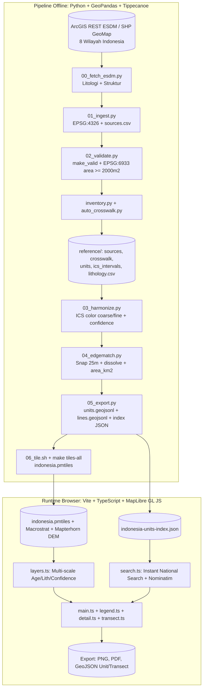

# Orebit GeoAtlas SPEC — Kontrak Teknis, Skema Nasional & Rubrik 100/100

| Kontrol dokumen | |
|---|---|
| Sistem | Orebit GeoAtlas — Pipeline Harmonisasi Geologi Nasional (`pipeline/`, `reference/`) & Aplikasi Web (`app/`) |
| Versi dokumen | 2.0 — 21 November 2026 |
| Status | Aktif; melengkapi [PRD](PRD.md); antrean kerja tunggal di [TASKS](PLAN-geoatlas.md) |
| Pemilik | Ghozian Islam Karami / Orebit |
| Pembaca | Engineer, geolog kurator, serta agent eksekutor dan reviewer yang mengerjakan Work Packages |

Dokumen ini menjawab **bagaimana**: pemilik kode, kontrak skema data, aturan pipeline 8 wilayah nasional, kontrak UI/UX bebas tabrakan, matriks state, pengujian otomatis, dan rubrik kualitas 45 cek (`§10`).

---

## 0. Ringkasan Sistem & Arsitektur

Orebit GeoAtlas terdiri atas dua subsistem terpisah tanpa backend runtime:
1. **Pipeline Harmonisasi Geologi Nasional (`pipeline/` + `reference/`)**: Mengambil data vektor geologi & struktur per wilayah dari layanan ArcGIS REST ESDM atau shapefile GeoMap, memvalidasi geometri dalam proyeksi Equal-Area, memetakan simbol ke satuan baku (`units.csv`) dan skala waktu ICS (`ics_intervals.csv`), menyatukan batas lembar (`04_edgematch.py`), serta mengekspor `PMTiles` (`06_tile.sh`) dan katalog indeks pencarian nasional (`app/public/data/indonesia-units-index.json`).
2. **Aplikasi Web Statis (`app/`)**: Aplikasi TypeScript + Vite + MapLibre GL JS + PMTiles yang merender geologi multi-skala (2D & terrain 3D), pencarian instan lintas Indonesia, filter interaktif stratigrafi/litologi, alat ukur & profil lintasan geologi, serta ekspor PNG/PDF/GeoJSON langsung di browser.



---

## 1. Pemilik Kode (Code Ownership)

| Area | File Kanonik | Tanggung Jawab Utama | Tes Kontrak |
|---|---|---|---|
| Utilitas & Konstanta Pipeline | `pipeline/common.py` | Path `RAW`/`OUT`/`REF`, daftar kandidat kolom KUGI/GeoMap, pembaca CSV komentar-aman, konstanta `REGION_BBOX` 8 wilayah | `tests/test_pipeline_contracts.py` |
| Penarik Data ESDM | `pipeline/00_fetch_esdm.py` | Query bbox 8 wilayah untuk layer poligon litologi & layer garis struktur ESDM dengan retry & laporan atribut | `tests/test_pipeline_contracts.py` |
| Ingest & Validasi Geometri | `pipeline/01_ingest.py`, `pipeline/02_validate.py` | Normalisasi CRS `EPSG:4326`, perbaikan `make_valid`, filter luas `EPSG:6933 ≥ 2000 m²`, laporan `qa_report.csv` | `tests/test_pipeline_contracts.py` |
| Inventaris & Auto-Crosswalk | `pipeline/inventory.py`, `pipeline/auto_crosswalk.py` | Deteksi simbol baru terurut luas (`km²`), klasifikasi deterministik umur (`AGE_MAP`) & litologi (`LITH_RULES`), penandaan `confidence="auto"` | `tests/test_pipeline_contracts.py` |
| Harmonisasi, Edge-Match & Ekspor | `pipeline/03_harmonize.py`, `pipeline/04_edgematch.py`, `pipeline/05_export.py`, `pipeline/06_tile.sh` | Pewarnaan ICS kasar/halus, penggabungan poligon lintas lembar, hitung `area_km2`, ekspor `GeoJSONSeq`, `PMTiles`, dan `indonesia-units-index.json` | `tests/test_pipeline_contracts.py` |
| Validator Referensi | `pipeline/validate_reference.py` | Cek integritas `sources.csv`, `crosswalk.csv`, `units.csv` (termasuk kolom `confidence`), `lithology.csv`, `ics_intervals.csv` | `make validate` |
| Konfigurasi & State URL | `app/src/config.ts`, `app/src/state.ts` | Daftar 8 wilayah + bbox pulau, daftar basemap, serialisasi state lengkap ke URL hash (`#map=...&mode=...&age=...&lith=...&conf=...&base=...`) | `tests/test_app_contracts.mjs` |
| Skala Waktu & Litologi | `app/src/timescale.ts`, `app/src/lithology.ts` | Definisi `ERA_PRESETS`, `PERIODS`, `EPOCHS`, `LITH_CLASSES`, `LITH_PARENT_GROUPS`, ekspresi warna MapLibre | `tests/test_app_contracts.mjs` |
| Layer Peta & Filter | `app/src/layers.ts` | Layer Macrostrat & Orebit, ekspresi filter umur + filter litologi + filter tingkat kurasi (`confidence`), highlight poligon | `tests/test_browser_uiux.py` |
| Legenda Interaktif | `app/src/legend.ts` | Render kolom stratigrafi ICS & daftar litologi sebagai tombol filter interaktif dengan indikator aktif & tombol reset | `tests/test_browser_uiux.py` |
| Pencarian Nasional | `app/src/search.ts` | Pemuatan `indonesia-units-index.json`, pencarian instan formasi/simbol/litologi/wilayah dari semua zoom + Nominatim + navigasi keyboard | `tests/test_app_contracts.mjs`, `tests/test_browser_uiux.py` |
| Detail Unit & Provenance | `app/src/detail.ts` | Drawer detail unit: pita posisi stratigrafi, luas `km²`, badge `confidence`, struktur sekitar, publikasi Crossref, unduh GeoJSON, lapor koreksi | `tests/test_browser_uiux.py` |
| Alat Geolog (Koordinat & Transek) | `app/src/coords.ts`, `app/src/transect.ts` | Konversi Lat/Lon ↔ UTM live, pin titik, alat ukur jarak/azimuth & generator profil strip-log lintasan geologi | `tests/test_app_contracts.mjs`, `tests/test_browser_uiux.py` |
| Orkestrasi UI & Ekspor | `app/src/main.ts`, `app/index.html`, `app/src/style.css` | Layout anti-tabrakan, Island Quick-Jump Bar, bottom sheet 3-snap seluler, basemap switcher, ekspor PNG/PDF/GeoJSON | `tests/test_browser_uiux.py` |
| Lokalisasi & Tentang | `app/src/i18n.ts`, `app/src/about.ts` | Kamus lengkap ID/EN tanpa key hilang, dialog Tentang & metodologi kurasi 8 wilayah | `tests/test_app_contracts.mjs` |

---

## 2. Kontrak Data & Skema

### 2.1 Pembagian 8 Wilayah Nasional (`REGION_BBOX`)

Seluruh wilayah Indonesia dibagi ke dalam 8 kotak pembatas (EPSG:4326: `lon_min, lat_min, lon_max, lat_max`) yang saling bersambung tanpa celah daratan:

| Kode `region` | Nama Wilayah (ID / EN) | BBox `(lon_min, lat_min, lon_max, lat_max)` |
|---|---|---|
| `sumatra` | Sumatra / Sumatra | `(95.0, -6.5, 105.0, 6.5)` |
| `babel` | Bangka-Belitung & Kep. Riau / Bangka-Belitung & Riau Islands | `(105.0, -3.6, 109.0, 4.8)` |
| `jawa` | Jawa & Madura / Java & Madura | `(105.0, -9.0, 114.6, -5.0)` |
| `balinusra` | Bali & Nusa Tenggara / Bali & Lesser Sunda Islands | `(114.4, -11.2, 125.5, -8.0)` |
| `kalimantan` | Kalimantan / Kalimantan (Indonesian Borneo) | `(108.5, -4.5, 119.2, 4.6)` |
| `sulawesi` | Sulawesi / Sulawesi | `(118.8, -6.8, 125.8, 5.8)` |
| `maluku` | Kepulauan Maluku / Maluku Islands | `(124.0, -9.2, 135.0, 2.8)` |
| `papua` | Papua / Papua | `(129.5, -9.5, 141.2, 1.0)` |

### 2.2 Skema `reference/units.csv`

Kolom wajib:
`unit_id,formation,symbol_std,lith_class,lith_detail,age_top_ma,age_base_ma,interval_top,interval_base,color_hex,confidence,description`

Aturan validasi (`pipeline/validate_reference.py`):
1. `unit_id` unik, hanya huruf kapital/angka/garis bawah (`^[A-Z0-9_]+$`).
2. `0 <= float(age_top_ma) <= float(age_base_ma) <= 4567`.
3. `lith_class` wajib salah satu dari 8 nilai di `reference/lithology.csv` (`unconsolidated`, `carbonate`, `siliciclastic`, `volcanic`, `plutonic_felsic`, `plutonic_mafic`, `metamorphic`, `melange`).
4. `confidence` wajib salah satu dari:
   - `curated`: telah diverifikasi terhadap lembar peta/leksikon stratigrafi;
   - `auto`: hasil pemetaan deterministik `auto_crosswalk.py`;
   - `flagged`: terdapat konflik teridentifikasi antara atribut sumber dan publikasi geologi pembanding (wajib dijelaskan di `description`).

### 2.3 Skema Indeks Pencarian Nasional (`app/public/data/indonesia-units-index.json`)

```json
{
  "schema": "orebit-geoatlas-index-v1",
  "generated_at": "2026-11-21",
  "regions": ["babel", "sumatra", "jawa", "balinusra", "kalimantan", "sulawesi", "maluku", "papua"],
  "units": [
    {
      "unit_id": "TRJKG",
      "symbol": "TRJkg",
      "formation": "Granit Klabat",
      "region": "babel",
      "lith_class": "plutonic_felsic",
      "lith_detail": "granit, granodiorit",
      "age_top_ma": 143.1,
      "age_base_ma": 251.902,
      "interval_top": "Jura",
      "interval_base": "Trias",
      "color_hex": "#812B92",
      "confidence": "flagged",
      "polygons": 55,
      "area_km2": 3638.9,
      "bbox": [105.12, -2.85, 106.72, -1.52]
    }
  ]
}
```

### 2.4 Skema Atribut Layer PMTiles (`units` & `lines`)

- Layer **`units`** (Polygon/MultiPolygon):
  `poly_id`, `unit_id`, `region`, `formation`, `symbol`, `lith_class`, `lith_parent`, `lith_detail`, `age_top_ma`, `age_base_ma`, `interval_top`, `interval_base`, `color_hex`, `color_hex_coarse`, `confidence`, `area_km2`, `description`, `sheet_name`, `source_url`, `source_id`.
- Layer **`lines`** (LineString/MultiLineString):
  `line_id`, `region`, `source_id`, `type` (`fault` | `anticline` | `syncline` | `contact`), `certainty` (`certain` | `inferred`), `name`.

---

## 3. Kontrak UI/UX 100/100 & Tata Letak Anti-Tabrakan

### 3.1 Arsitektur Ruang Layar Desktop (`> 760px`)

Untuk mencegah tabrakan antara `.detail` dan `.map-ctrls`:
1. **Zona Kiri (`left: 12px; top: 12px; bottom: 12px; width: 336px`)**: Panel kontrol utama (`.panel`) berisi Header Brand, Kotak Pencarian Nasional, Chip Pulau Quick-Jump, Segmented Mode Warna, Chip Preset Era + Slider Rentang Umur, Filter Tingkat Kurasi & Struktur, Slider Opasitas, dan Legenda Interaktif (Stratigrafi / Litologi).
2. **Zona Kanan Atas (`right: 14px; top: 14px`)**: Toolbar navigasi peta (`.map-ctrls`) yang ramping dan terorganisasi (Zoom `+/-`, Locate, 2D/3D, Kompas/Rotasi 3D, Pemilih Basemap & Ekspor).
3. **Zona Kanan Bawah Toolbar (`right: 14px; top: 64px` atau `top: 104px` saat 3D aktif; `bottom: 44px; width: 356px`)**: Drawer detail unit (`.detail`) dan panel hasil Transek Geologi **selalu muncul di bawah `.map-ctrls` (`top: var(--detail-top, 64px)`)**, tidak pernah berada pada koordinat Y yang sama dengan `.map-ctrls`!
4. **Zona Bawah Tengah–Kanan (`right: 14px; bottom: 10px`)**: Bar status koordinat live (`Lat/Lon · UTM · Zoom · Skala`) dan atribusi ringkas.

### 3.2 Arsitektur Ruang Layar Seluler (`≤ 760px`)

1. **Bottom Sheet 3-Snap-Point (`peek` = 116px, `half` = 48vh, `full` = 82vh)**:
   - Saat **Peek (`116px`)**: Handle geser + baris Brand/Bahasa + **Kotak Pencarian Nasional** + **Strip Horizontal Chip Pulau / Filter Aktif** tetap terlihat dan langsung bisa dipakai tanpa harus menarik sheet ke atas terlebih dahulu.
   - Saat **Half (`48vh`)**: Menampilkan mode warna, chip preset era, slider umur, filter struktur/opasitas.
   - Saat **Full (`82vh`)**: Menampilkan kolom stratigrafi ICS dan kelas litologi interaktif secara penuh.
2. **Kartu Detail Seluler**: Muncul sebagai sheet kontekstual yang rapi dengan tombol aksi sticky di bagian bawah (*Fokus*, *GeoJSON*, *Salin*, *Koreksi*).

### 3.3 Matriks 11 State Aplikasi Wajib

Setiap state wajib memiliki indikator visual yang jelas (tidak mengandalkan toast sesaat saja), teks dwibahasa ID/EN, dan fokus keyboard yang sehat:
1. `initial-national` (Tampilan awal Indonesia zoom 4.2 dengan chip pulau & pencarian siap)
2. `searching` (Live dropdown menampilkan hasil instan unit nasional + lokasi)
3. `search-empty` (Pesan ramah + saran kata kunci contoh seperti *Muara Enim*, *TRJkg*, *Bandung*)
4. `filtered-age` (Rentang umur disaring via slider/era/legenda; badge filter aktif + tombol Reset tampil)
5. `filtered-lith` (Kelas litologi disaring via klik legenda; poligon non-cocok diredupkan, badge aktif + tombol Reset tampil)
6. `filtered-confidence` (Hanya menampilkan unit `curated` atau `flagged`/`auto`)
7. `unit-selected` (Poligon disorot kuning emas `#E3B505`, drawer `.detail` tampil di bawah `.map-ctrls` tanpa tabrakan)
8. `transect-measuring` (Mode klik titik lintasan aktif; garis ukur, jarak km, azimuth, dan strip-log formasi terpotong tampil)
9. `terrain-3d` (Mode medan 3D aktif; kontrol pitch/bearing tampil; fallback aman bila DEM gagal)
10. `exporting` (Status penyusunan kanvas PNG/PDF/GeoJSON resolusi tinggi)
11. `offline-degraded` (Peringatan non-blocking bila PMTiles/eksternal gagal dimuat, peta dasar/indeks lokal tetap berfungsi)

---

## 4. Kontrak Ilmiah: Konversi UTM & Profil Lintasan Geologi (Transect)

1. **Konversi Lat/Lon ke UTM (`app/src/coords.ts`)**:
   - Menghitung nomor zona UTM: `zone = Math.floor((lon + 180) / 6) + 1` (untuk Indonesia: Zona `46N`–`54N` dan `46S`–`54S`).
   - Menghitung huruf pita lintang (`M` atau `L` untuk belahan selatan, `N` untuk belahan utara khatulistiwa) serta koordinat `Easting (mE)` dan `Northing (mN)` memakai rumus proyeksi Transverse Mercator WGS84 dengan akurasi `< 1 meter`.
2. **Profil Lintasan Geologi (`app/src/transect.ts`)**:
   - Menghitung jarak geodesik Haversine antar-titik (`km`) dan azimuth awal (`0°–360°`).
   - Mencuplik `N = 64` titik sampel merata di sepanjang segmen lintasan (`map.project(lngLat)` → `map.queryRenderedFeatures(point, { layers: queryLayers() })`), lalu mengelompokkan segmen berurutan yang memiliki satuan geologi yang sama ke dalam pita **Geological Strip-Log** (menampilkan proporsi panjang `%`, jarak `km`, warna unit, simbol, nama formasi, dan umur).

---

## 5. Pengujian Otomatis & Known-Answer Oracle

1. **Suite Kontrak Pipeline & Referensi (`tests/test_pipeline_contracts.py`)**:
   - Memverifikasi keabsahan semua berkas `reference/*.csv` (`validate_reference.py`).
   - Memverifikasi `REGION_BBOX` memuat tepat 8 wilayah nasional Indonesia yang mencakup seluruh rentang `95°BT–141°BT`.
   - Known-answer `AGE_MAP` & `LITH_RULES` di `auto_crosswalk.py` untuk ≥25 kasus uji stratigrafi Indonesia.
   - Known-answer koreksi audit geologi (`TRJKG` Trias–Jura `143.1–251.902 Ma`, `PUK` `flagged`, `PCKS1` metasedimen).
   - Validasi skema dan isi `app/public/data/indonesia-units-index.json`.
2. **Suite Kontrak Aplikasi & Algoritma (`tests/test_app_contracts.mjs`)**:
   - Known-answer konversi WGS84 → UTM di titik referensi Indonesia (Banda Aceh `46N`, Jakarta `48M`, Makassar `50M`, Jayapura `54M`).
   - Known-answer perhitungan jarak Haversine & azimuth lintasan geologi.
   - Known-answer pencarian indeks nasional (pencarian simbol `TRJkg`, formasi `Muara Enim`, litologi `volcanic`, wilayah `jawa`/`kalimantan`/`papua`).
   - Paritas kamus lokalisasi `id` vs `en` di `app/src/i18n.ts` (setiap key wajib ada dan tidak kosong di kedua bahasa).
   - Roundtrip serialisasi `readState()` / `writeState()` untuk semua parameter URL hash.
3. **Suite Browser E2E Playwright (`tests/test_browser_uiux.py`)**:
   - Menguji aplikasi ter-build pada viewport desktop (`1366×768`) dan seluler (`375×812`) dalam bahasa `id` dan `en`.
   - **Tes Anti-Tabrakan (`Zero Overlap Assertion`)**: Membuka detail unit di desktop dan membuktikan `boundingBox(.detail)` **tidak beririsan** dengan `boundingBox(.map-ctrls)` maupun `boundingBox(.panel)`.
   - Menguji live search typeahead, klik chip pulau (*Island Quick-Jump*), klik chip preset era, klik baris kolom stratigrafi ICS & litologi untuk filter, mode alat ukur/transek, ganti bahasa ID/EN, dialog Tentang, serta ekspor PNG/PDF/GeoJSON tanpa `pageerror`.

---

## 6. Rubrik Kualitas 100/100 (9 Dimensi × 5 Cek = 45 Cek Biner)

Setiap cek bernilai biner (1 = Lulus dengan bukti otomatis/artefak, 0 = Parsial/Belum diuji). Nilai dimensi = `(lulus / 5) × 100`.

| Dimensi | Bobot | 5 Cek Biner Wajib (Total 45 Cek) |
|---|---:|---|
| **1. UI/UX & Tata Letak** | 20 | (1.1) Zero-overlap `.panel`, `.map-ctrls`, `.detail`, `.map-foot` di 1366×768; (1.2) Bottom sheet 3-snap di 375×812 dengan search & chip tetap terlihat saat peek; (1.3) Legenda stratigrafi & litologi interaktif klik-untuk-filter + reset; (1.4) Chip preset era + slider umur responsif; (1.5) Uji pengguna `HUM-1` ≥5 peserta lulus mandiri |
| **2. Data Geologi Nasional** | 15 | (2.1) 8 wilayah nasional terdaftar di `REGION_BBOX` & `indonesia-units-index.json`; (2.2) Temuan audit (`TRJKG`, `PUK`, `PCKS1`) terkoreksi di `units.csv`; (2.3) Kolom `confidence` (`curated`/`auto`/`flagged`) valid 100%; (2.4) `AGE_MAP` & `LITH_RULES` menutup seluruh istilah era/periode/epoch Indonesia; (2.5) Dukungan layer garis struktur/sesar (`lines`) |
| **3. Pencarian & Navigasi** | 15 | (3.1) Pencarian unit/simbol/formasi nasional bekerja dari zoom 4; (3.2) Live typeahead debounce ≤180ms + tombol clear; (3.3) Navigasi keyboard `ArrowUp`/`ArrowDown`/`Enter`/`Escape` di hasil cari; (3.4) Island Quick-Jump Bar 8 wilayah berfungsi; (3.5) Geocoding lokasi Nominatim Indonesia terintegrasi aman |
| **4. Alat Kerja Geolog & Ekspor** | 10 | (4.1) Bar koordinat Lat/Lon + Zona UTM + Zoom live & salin titik; (4.2) Alat ukur jarak, azimuth & profil strip-log lintasan geologi; (4.3) Kartu detail menampilkan pita stratigrafi, luas `km²`, badge `confidence`, struktur & literatur; (4.4) Ekspor GeoJSON unit & lintasan + tombol Lapor Koreksi; (4.5) Ekspor PNG & PDF beresolusi tinggi dengan kompas, skala, legenda & atribusi |
| **5. Stabilitas & State** | 10 | (5.1) Roundtrip penuh state di URL hash (`mode`, `age`, `lith`, `conf`, `base`, `lines`, `topo`, `view`, `geo`, `lang`); (5.2) Basemap switcher (Terang/Gelap/Topografi) mempertahankan layer geologi; (5.3) Fallback aman saat tile DEM/PMTiles/API eksternal lambat atau gagal; (5.4) Transisi 2D↔3D bebas race-condition; (5.5) Bebas `pageerror` dan exception tak tertangani di browser |
| **6. Arsitektur & Pipeline** | 10 | (6.1) Perhitungan luas poligon memakai proyeksi Equal-Area `EPSG:6933`; (6.2) `04_edgematch.py` & `05_export.py` menghasilkan `area_km2`, `confidence`, dan `indonesia-units-index.json`; (6.3) `make combine` & `make tiles-all` membangun bundel nasional; (6.4) Pemisahan bersih modul TS (`config`, `state`, `layers`, `legend`, `search`, `detail`, `coords`, `transect`, `i18n`); (6.5) Build reproduktif `npm run build` tanpa warning tipe |
| **7. Performa** | 10 | (7.1) Bundle JS aplikasi utama `< 350 KB` gzipped; (7.2) Ukuran tiap vector tile PMTiles `< 500 KB`; (7.3) Pencarian pada indeks nasional `< 100 ms`; (7.4) Update filter umur/litologi berjalan mulus tanpa rebuild layer; (7.5) Caching fetch indeks, sumber Macrostrat, dan referensi Crossref |
| **8. Pengujian & Tata Kelola** | 5 | (8.1) `make validate` & `test_pipeline_contracts.py` lulus; (8.2) `test_app_contracts.mjs` known-answer lulus; (8.3) Suite Playwright `test_browser_uiux.py` desktop & mobile ID/EN lulus; (8.4) `check-docs.py`, `check-plan-registry.py`, dan `wp.py check` lulus; (8.5) `local-ci.sh --full --write-receipt` menghasilkan receipt exact-SHA |
| **9. Aksesibilitas & Keamanan** | 5 | (9.1) Kontras teks & chip memenuhi WCAG 2.2 AA; (9.2) Fokus keyboard & `Escape` pada dialog, menu tools, search, dan detail; (9.3) Target sentuh seluler `≥ 44×44 px`; (9.4) Seluruh string data di-escape (`esc()`) terhadap XSS dan URL eksternal divalidasi; (9.5) Kepatuhan lisensi & atribusi PSG, Macrostrat, OSM, dan Mapterhorn di UI dan ekspor |

---

## 7. Matriks Keterlacakan (Traceability Matrix)

| ID PRD | Bagian SPEC | Tugas di `PLAN-geoatlas.md` | Work Package | Tes Pembuktian |
|---|---|---|---|---|
| DAT-1..4 | §2.1, §2.2 | `DAT-01`, `DAT-02`, `DAT-03`, `DAT-04`, `DAT-05` | `WP-01`, `WP-05`, `WP-06`, `WP-07` | `validate_reference.py`, `test_pipeline_contracts.py` |
| DAT-5..6, PIP-1..4 | §2.3, §2.4 | `PIP-01`, `PIP-02`, `PIP-03`, `PIP-04` | `WP-02`, `WP-07` | `test_pipeline_contracts.py` |
| MAP-1..4 | §1, §2.4 | `MAP-01`, `MAP-02` | `WP-09` | `test_browser_uiux.py` |
| SRC-1..3 | §2.3, §3 | `SRC-01`, `SRC-02` | `WP-08`, `WP-11` | `test_app_contracts.mjs`, `test_browser_uiux.py` |
| UIX-1..6 | §3.1, §3.2, §3.3 | `UIX-01`, `UIX-02`, `UIX-03`, `UIX-04`, `UIX-05`, `UIX-06` | `WP-03`, `WP-10`, `WP-11`, `WP-15` | `test_browser_uiux.py`, `test_app_contracts.mjs` |
| TOOL-1..3 | §4 | `TOOL-01`, `TOOL-02`, `TOOL-03` | `WP-03`, `WP-12`, `WP-13` | `test_app_contracts.mjs`, `test_browser_uiux.py` |
| EXP-1..3 | §1, §6 | `EXP-01`, `TOOL-02` | `WP-12`, `WP-14` | `test_browser_uiux.py` |
| NFR-1..5 | §5, §6 | `TEST-01`, `TEST-02`, `REL-01`, `REL-02`, `HUM-01`, `VAL-01` | `WP-16`, `WP-17`, `WP-18`, `WP-19`, `WP-20` | `local-ci.sh --full --write-receipt` |
