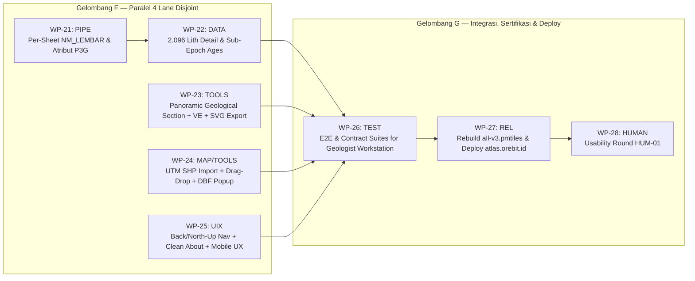

# Audit Komprehensif Senior Geologist & UI/UX — Orebit GeoAtlas (21 November 2026)

| Atribut Audit | Rincian |
|---|---|
| Tanggal | 21 November 2026 |
| Lingkup | Audit Geologi Regional 8 Wilayah (`data/raw/`, `reference/`, `pipeline/`), Penampang Geologi Bawah Permukaan (`transect.ts`), Workstation Impor SHP/GeoJSON/KML (`shp_import.ts`), Navigasi & Orientasi (`main.ts`), Pembersihan Jargon Teknis (`about.ts`, `detail.ts`), dan Optimasi Seluler (`style.css`) |
| Auditor | Senior Exploration Geologist & Principal UI/UX Architect |
| Rencana Eksekusi | Diterjemahkan ke dalam **Gelombang F & G (`WP-21` s/d `WP-28`)** pada [TASKS](../PLAN-geoatlas.md) dan [WORK-PACKAGES](../handover/WORK-PACKAGES-geoatlas.md) |

---

## 1. Ringkasan Eksekutif

Berdasarkan pemeriksaan menyeluruh terhadap dataset vektor lokal (`data/raw/`), tabel referensi (`reference/*.csv`), pipeline pembentukan tile (`pipeline/*.py`), dan aplikasi web (`app/src/*`), ditemukan **6 kelompok temuan utama** yang membedakan sekadar "penampil peta poligon" dari **Workstation Geologi Eksplorasi & Regional** yang benar-benar aplikatif di lapangan maupun kantor:

1. **Provenance Sumber Data & Atribut Lembar Peta (`NM_LEMBAR` / `NO_LEMBAR`):**
   - Data vektor lokal berasal dari **Kompilasi Peta Geologi Bersistem Indonesia Skala 1:250.000 & 1:1.000.000 (Pusat Penelitian dan Pengembangan Geologi / P3G & Pusat Survei Geologi, Badan Geologi)**, bukan sekadar layanan web MapServer ESDM Mei 2018.
   - Setiap poligon pada berkas `.TAB`/`.shp` menyimpan nama dan nomor lembar asli (`NM_LEMBAR` / `NAME_OF_SH` dan `NO_LEMBAR` / `NUMBER_OF_`, mis. `Lembar Pangkalpinang 1113`, `Lembar Tanjung Pandan 1213`, `Lembar Bandung 1209`, `Lembar Malinau 1819`, `Lembar Morotai 2617`), namun sebelumnya atribut lembar per-poligon ini belum dibawa ke `04_units.parquet` → `all.pmtiles`.
2. **Kelengkapan Deskripsi Litologi (`lith_detail`) & Presisi Sub-Kala Stratigrafi:**
   - Dari **2.096** unit di `reference/units.csv`, sebanyak **2.014 unit (96,1%)** masih memiliki `lith_detail` kosong (`""`), **42 unit** masih memakai rentang umur Fanerozoikum generik (`0–538,8 Ma`), dan **44 unit** memakai rentang Tersier generik (`2,58–66,0 Ma`).
   - Padahal berkas lokal seperti `Geology-West Java.TAB` (`DESKRIP`, `DESCRIP`), `geological map timor/*/*.shp` (`CLASS_LITH`, `DOMLITH1..4`, `B_EPOCH_E`, `T_EPOCH_E`), dan `litoirian.tab` (`UMUR`, `PEMBAWA`, `MINERAL`) memiliki informasi litologi, lingkungan pengendapan, dan mineral pembawa yang kaya.
3. **Penampang Geologi Bawah Permukaan (`Geological Cross-Section A — A'`):**
   - Geolog membutuhkan **penampang geologi bawah permukaan berukuran lebar (panoramik)** yang menampilkan **lapisan stratigrafi bertingkat menurut kedalaman** (Endapan Kuarter di atas bidang ketidakselarasan, runtunan sedimen/vulkanik miring & terlipat dengan garis perlapisan internal, tubuh intrusi/batolit plutonik yang memotong dari bawah, serta batuan dasar/*basement* di bagian bawah), **arsiran litologi standar USGS/FGDC**, **bidang patahan/sesar miring dengan arah pergeseran blok (*throw* `↑`/`↓`)**, kontrol **Perbesaran Vertikal (`VE: 1×, 2×, 5×, 10×`)**, kursor sinkron peta–penampang, serta tombol **Unduh SVG/PNG Penampang**.
4. **Workstation Cek Lokasi & Impor SHP / GeoJSON / KML (`shp_import.ts`):**
   - Sebagian besar shapefile konsesi tambang (WIUP/IUP) dan pemetaan lapangan di Indonesia menggunakan proyeksi **UTM Zona 46N–54S (meter)**, sering kali diunggah hanya berupa `.shp` tanpa `.prj` atau dalam arsip `.zip`.
   - Diperlukan reproyeksi otomatis UTM ↔ WGS84 dengan pemilih zona UTM interaktif (`UTM 46N..54S`), marker pin lokasi yang langsung terlihat mencolok di peta (`📍`), dukungan *drag-and-drop* langsung ke kanvas peta, klik fitur SHP untuk melihat atribut `.dbf`, serta **perhitungan luas irisan formasi (`ha` & `%`)** di dalam poligon area kerja.
5. **Navigasi Kamera (`Back` & `Northing Up`) dan Pembersihan Jargon Internal:**
   - Kontrol orientasi utara (`Northing Up`) sebelumnya tersembunyi pada mode 2D, dan belum ada tombol `Back` untuk kembali ke tampilan kamera sebelumnya setelah berpindah-pindah pulau/pencarian.
   - Dialog *Tentang (`About`)*, sidebar, dan panel detail sebelumnya menampilkan istilah internal pipeline (`auto_crosswalk.py`, `[AUTO]`, `Curation confidence levels`, `Automated Mapping`). Seluruh jargon internal/skrip tersebut harus dihapus dari antarmuka pengguna dan digantikan dengan penjelasan metodologi stratigrafi ICS dan skala kompilasi peta (`Skala 1:250.000 · P3G / PSG`).
6. **Optimasi Ergonomi Seluler (`≤ 760px`):**
   - Panel penampang geologi dan detail unit di layar seluler membutuhkan koordinasi otomatis dengan *bottom sheet* 3-snap (`peek`/`half`/`full`), *scroll* horizontal mulus pada SVG penampang panoramik, dan ruang baca yang lega tanpa menabrak `.map-foot` maupun `.map-ctrls`.

---

## 2. Matriks Temuan & Pemetaan ke Work Packages (Gelombang F & G)

| Kode Temuan | Area | Masalah yang Ditemukan | Solusi Teknis & Geologi | Tugas | Work Package |
|---|---|---|---|---|---|
| **AUD-01** | `pipeline/`, `reference/` | `sheet_name` per poligon belum membawa `NM_LEMBAR` + `NO_LEMBAR` asli dari `.TAB`/`.shp`, dan atribut ekstra Timor/Jawa Barat/Papua (`PEMBAWA`, `MINERAL`, `CLASS_LITH`) belum diekstrak | Ekstrak `NM_LEMBAR`/`NAME_OF_SH` + `NO_LEMBAR` per poligon di `01_ingest.py` → `04_edgematch.py` → `05_export.py`; perbarui `sources.csv` ke kompilasi P3G 1:250.000 | `PIP-05` | `WP-21` |
| **AUD-02** | `reference/units.csv` | 2.014 unit belum memiliki `lith_detail`, dan 86 unit masih berumur generik (`0–538,8 Ma` / `2,58–66,0 Ma`) | Sintesis `lith_detail` geologis baku untuk seluruh 2.096 unit berdasarkan formasi/kelompok batuan + Leksikon Stratigrafi; tajamkan parser sub-kala (`Tml`, `Tmm`, `Tmu`, `Tpl`, `Tpu`, `Tol`, `Tou`, `Tel`, `Teu`, `Kl`, `Ku`, `Jl`, `Ju`) | `DAT-06`, `DAT-07` | `WP-22` |
| **AUD-03** | `app/src/transect.ts` | Penampang geologi sebelumnya sempit (`356px`), hanya 1 lapis di bawah topografi, tanpa kontrol *Vertical Exaggeration* (`VE`), tanpa kursor sinkron peta, dan belum bisa ekspor gambar penampang (`SVG`/`PNG`) | Dock penampang panoramik (`740px–880px`), 3 horizon stratigrafi bawah permukaan + pergeseran blok patahan (*throw* `↑↓`) + batolit memotong + arsiran USGS, pemilih `VE (1×/2×/5×/10×)`, hover sinkron ke peta, dan ekspor `SVG` + `CSV` | `TOOL-04` | `WP-23` |
| **AUD-04** | `app/src/shp_import.ts` | SHP berkoordinat UTM tidak terlihat/tidak zoom, belum ada *drag-and-drop* di peta, popup atribut `.dbf`, dan laporan persentase/luas formasi di dalam WIUP | Reproyeksi otomatis UTM 46N–54S & WebMercator → WGS84 + dropdown pemilih CRS/UTM, pin marker mencolok (`📍`), *drag-and-drop* file ke peta, popup atribut `.dbf` saat fitur diklik, dan ekspor CSV hasil cek lokasi | `TOOL-05` | `WP-24` |
| **AUD-05** | `app/src/main.ts`, `about.ts`, `detail.ts`, `style.css` | Tombol `Back` riwayat kamera & kompas `Northing Up` 2D/3D belum selalu tampil; teks `About` & `Detail` memuat jargon `auto_crosswalk.py` / `[AUTO]`; tampilan seluler perlu disempurnakan | Tambahkan `#navBack` (`←`) & `#compassNorthBtn` (`N▲`) permanen di `.map-ctrls`, bersihkan seluruh jargon skrip/otomatis dari UI, dan optimalkan *bottom sheet* + *scroll* penampang di seluler | `UIX-06` | `WP-25` |
| **AUD-06** | `tests/` | Suite tes otomatis perlu mencakup konversi UTM↔WGS84 SHP, penampang geologi multi-horizon + patahan, bebas jargon `auto_crosswalk.py` di DOM, serta navigasi `Back`/`Northing Up` | Perluas `tests/test_pipeline_contracts.py`, `tests/test_app_contracts.mjs`, dan `tests/test_browser_uiux.py` | `TEST-03` | `WP-26` |
| **AUD-07** | `data/out/all/`, VPS | Pembangunan ulang `all-v3.pmtiles` dengan `sheet_name` per lembar & `lith_detail` lengkap serta deploy terverifikasi ke `atlas.orebit.id` | Jalankan pipeline 8 wilayah → `all-v3.pmtiles` + `indonesia-units-index.json`, lulus `local-ci.sh --full --write-receipt`, dan deploy ke `orebit-vps2` | `REL-02` | `WP-27` |
| **AUD-08** | `docs/audits/` | Uji usability `HUM-01` dengan ≥5 geolog/mahasiswa menggunakan fitur baru (Penampang Geologi, Impor SHP WIUP, Navigasi) | Perbarui skenario `docs/audits/hum-1-geoatlas.md` dan rekam hasil peserta nyata | `HUM-01` | `WP-28` |

---

## 3. Urutan Gelombang Eksekusi Multi-Agent (Wave F & Wave G)

